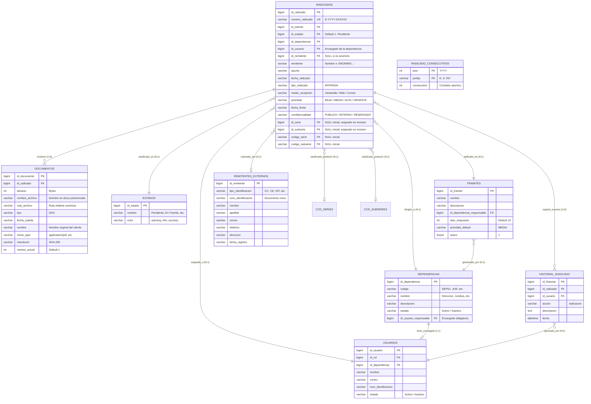

# Manual Técnico y Diccionario de Datos — Módulo de Radicación Documental
## Sistema de Seguimiento y Gestión Documental — Proyecto ODIN

**Dirigido a:** Equipo de Arquitectura de Software, Desarrolladores Backend/Frontend, Administradores de Base de Datos y QA  
**Entorno Tecnológico:** PHP 8.2+ Nativo (API RESTful) | MySQL 8.x/9.x (InnoDB, `utf8mb4`) | AdminLTE 3 / Bootstrap 4 | SweetAlert2 | DataTables  
**Módulo:** Radicación de Documentos Oficiales de Entrada (`UC-03`, `UC-04`, `UC-05`, `RF-05`, `RF-06`, `RF-09`, `RF-10`, `RF-23`)  
**Versión del Módulo:** 2.0.0  
**Fecha de Emisión:** Octubre de 2026  
**Normativa Aplicable:** Acuerdo 060 de 2001 (Archivo General de la Nación - AGN) | Ley 1712 de 2014 (Transparencia y Acceso a la Información Pública)  

---

## 1. Introducción y Alcance del Módulo

El **Módulo de Radicación Documental** es el núcleo de entrada de las comunicaciones y solicitudes externas dirigidas a la organización en el Sistema ODIN. Su función primordial es dar cumplimiento estricto a las directrices de la gestión documental colombiana (Acuerdo AGN 060 de 2001), garantizando que todo documento ingresado quede formalmente radicado con un número oficial consecutivo, fecha y hora legales, remitente identificado (u omitido bajo amparo de ley), anexos digitales verificados y asignación inmediata a la dependencia competente.

### 1.1. Objetivos del Módulo
1. **Recepción Unificada de Entrada:** Registrar de manera controlada y estandarizada todas las peticiones, quejas, reclamos, solicitudes y oficios que ingresan por ventanilla física o canales electrónicos.
2. **Consecutivo Oficial y No Repudiable:** Asignar un número consecutivo único anual de forma atómica (`E-YYYY-XXXXXX`), blindado contra condiciones de carrera mediante transacciones de bloqueo en MySQL.
3. **Autollenado Reactivo del Solicitante:** Reconocer automáticamente remitentes previamente registrados en la tabla `remitentes_externos` para optimizar los tiempos de atención en ventanilla.
4. **Protección a la Identidad (Radicación Anónima):** Implementar el mandato de la Ley 1712 de 2014, permitiendo el ingreso de solicitudes sin exigir identificación personal cuando el ciudadano así lo requiera.
5. **Direccionamiento Organizacional Exclusivo por Dependencia:** Asignar el trámite directamente a una dependencia operativa (`dependencias`), vinculando y protegiendo de forma automática al usuario encargado de dicha área (`id_usuario_responsable`).
6. **Desacoplamiento de la Clasificación TRD:** Deferir la asignación de series y subseries documentales a la fase posterior de *Revisión Documental* por parte del funcionario encargado, dejando libre a la ventanilla de radicación de decisiones de archivo de fondo.
7. **Seguridad Documental y Anti-Malware:** Inspeccionar el tipo MIME binario real de cada anexo, almacenar particionadamente en disco (`YYYY/MM/`), calcular hashes criptográficos SHA-256 y proteger con directivas de Apache `.htaccess`.

---

## 2. Reglas de Negocio Implementadas

| Código | Regla de Negocio | Descripción Técnica e Implementación |
| :--- | :--- | :--- |
| **RN-RAD-01** | **Tipo de Radicación Fijo (Entrada)** | Todo documento ingresado por este módulo corresponde estrictamente a una radicación de tipo `ENTRADA`. El formulario presenta un campo visual informativo no modificable y envía el valor fijo en el payload. |
| **RN-RAD-02** | **Estado Inicial Obligatorio (Pendiente)** | Todo nuevo radicado ingresa automáticamente en estado `Pendiente` (`id_estado = 1`). El usuario no puede alterar el estado inicial durante la radicación. |
| **RN-RAD-03** | **Autollenado Reactivo de Remitentes** | Al digitar el número de identificación del solicitante (con debounce de 400 ms), el sistema consulta `GET /api/remitentes/{documento}` y autollena nombre, correo, teléfono y dirección si ya existe en `remitentes_externos`. Si es nuevo, permite su captura e inserción automática. |
| **RN-RAD-04** | **Radicación Anónima (Ley 1712)** | Al activar el interruptor de radicación anónima, se limpian y deshabilitan los campos del solicitante, registrando en base de datos como remitente: `ANÓNIMO (Ley de Transparencia)` con `id_remitente = NULL`. |
| **RN-RAD-05** | **Asignación por Dependencia y Responsable Automático** | Los radicados no se asignan a personas arbitrarias, sino a una **Dependencia**. Al seleccionar la dependencia, el sistema consulta `GET /api/dependencias/{id}/responsable` y fija al funcionario encargado (`id_usuario_responsable`), bloqueando el campo para evitar manipulación. |
| **RN-RAD-06** | **Clasificación Documental Diferida** | Las series y subseries de la Tabla de Retención Documental (TRD) **NO** se asignan en la radicación. Se persisten inicialmente como `NULL` en `radicados` y serán establecidas por el encargado durante la revisión documental. |
| **RN-RAD-07** | **Anexo Digital Obligatorio** | Es mandatorio adjuntar al menos un (1) archivo digital para completar la radicación. |
| **RN-RAD-08** | **Validación Binaria y Límite de Peso** | Solo se admiten archivos con firma binaria real correspondiente a PDF (`application/pdf`), Excel (`.xlsx`, `.xls`) o imágenes (`.png`, `.jpg`, `.jpeg`). Peso máximo admitido: 15 MB por archivo. |
| **RN-RAD-09** | **Renombrado Preventivo y Estructura Particionada** | Los archivos físicos se renombran bajo el estándar: `DOC_[PREFIJO]_[YYYYMMDD]_[HASH_CORTO].[ext]` y se almacenan en `vistas/archivos/DOC/YYYY/MM/`. |
| **RN-RAD-10** | **Trazabilidad Inmutable** | Toda radicación exitosa crea un registro inicial en la tabla `historial_radicado` con acción `'radicacion'` y conteo de documentos adjuntos. |

---

## 3. Diagramas de Arquitectura y Flujo

### 3.1. Flujo del Proceso de Radicación de Entrada

```mermaid
flowchart TD
    Inicio([Inicio: Funcionario en Ventanilla]) --> AperturaForm[Carga de Formulario: Tipo='Entrada', Estado='Pendiente']
    AperturaForm --> CargaCatalogos[GET /api/radicados/catalogos: Carga Trámites y Dependencias]
    
    CargaCatalogos --> EsAnonimo{¿Es Radicación Anónima?}
    
    EsAnonimo -- Sí --> ActivarAnonimo[Inhabilita campos de remitente\nRemitente = 'ANÓNIMO']
    EsAnonimo -- No --> DigitaDoc[Digita Número de Documento]
    DigitaDoc --> Debounce[Debounce 400ms: GET /api/remitentes/{doc}]
    Debounce --> ExisteRem{¿Remitente Existe?}
    ExisteRem -- Sí --> Autollenar[Autollena: Nombre, Correo, Teléfono, Dirección]
    ExisteRem -- No --> IngresoManual[Completa datos del nuevo remitente]
    
    ActivarAnonimo --> SelecDep[Selecciona Dependencia Asignada]
    Autollenar --> SelecDep
    IngresoManual --> SelecDep
    
    SelecDep --> AutoEncargado[Autollenado y Bloqueo del Responsable:\nGET /api/dependencias/{id}/responsable]
    AutoEncargado --> DatosDoc[Diligencia Asunto, Prioridad, Folios, Fecha Límite]
    DatosDoc --> CargaAdjuntos[Adjunta Documentos Digitales: Drag & Drop / File]
    
    CargaAdjuntos --> Submit[Clic en 'Radicación Documental']
    Submit --> ValidaFront{¿Pasa Validación HTML5 y Mínimo 1 Adjunto?}
    ValidaFront -- No --> AlertaFront[SweetAlert2: Corregir Campos Requeridos]
    
    ValidaFront -- Sí --> EnvioAPI[POST /api/radicados (multipart/form-data)]
    
    subgraph Backend [Backend API RESTful]
        EnvioAPI --> ValidaMIME[ArchivoServicio: Inspección MIME Binario y Límite 15MB]
        ValidaMIME -- Rechazado --> ErrorMIME[HTTP 400: Archivo Inválido / Peligroso]
        ValidaMIME -- Aprobado --> Transaccion[Iniciar Transacción PDO]
        
        Transaccion --> SyncRemitente[Verificar / Insertar en remitentes_externos]
        SyncRemitente --> BloqueoConsecutivo[INSERT ... ON DUPLICATE KEY UPDATE en radicado_consecutivos]
        BloqueoConsecutivo --> GeneraNumero[Formato: E-YYYY-XXXXXX]
        GeneraNumero --> InsertaRadicado[INSERT en radicados\nid_serie=NULL, id_subserie=NULL]
        InsertaRadicado --> GuardaArchivos[Mover a vistas/archivos/DOC/YYYY/MM/\nINSERT en documentos]
        GuardaArchivos --> InsertaHistorial[INSERT en historial_radicado: 'radicacion']
        InsertaHistorial --> Commit[db->commit]
    end
    
    ErrorMIME --> SwalError[SweetAlert2: Notificar Error al Usuario]
    Commit --> Res201[HTTP 201 Created: Retorna Número Oficial]
    Res201 --> SwalExito[SweetAlert2: Modal con Número Oficial Asignado]
    SwalExito --> Limpiar[Reset Completo del Formulario]
    Limpiar --> Fin([Fin del Proceso])
```

---

### 3.2. Diagrama de Entidad-Relación (ERD) del Módulo



---

## 4. Diccionario de Datos Exhaustivo

### 4.1. Tabla: `radicados`
- **Propósito:** Almacena el encabezado maestro de cada comunicación oficial radicada en la entidad.
- **Motor de Almacenamiento:** InnoDB
- **Cotejamiento:** `utf8mb4_general_ci` / `utf8mb4_unicode_ci`

| Columna | Tipo de Dato | Nulo | Clave | Default | Descripción y Reglas de Negocio |
| :--- | :--- | :---: | :---: | :--- | :--- |
| `id_radicado` | `bigint(20)` | NO | **PK** | *Auto-increment* | Identificador secuencial interno y único del radicado. |
| `numero_radicado` | `varchar(255)` | NO | **UQ** | `NULL` | Código alfanumérico oficial visible (`E-2026-000042`). Único en todo el sistema. |
| `id_tramite` | `bigint(20)` | SÍ | **FK** | `NULL` | Clave foránea que referencia a `tramites(id_tramite)`. |
| `id_estado` | `bigint(20)` | SÍ | **FK** | `NULL` | Clave foránea hacia `estados(id_estado)`. Al radicar siempre se fija en `1` (Pendiente). |
| `id_dependencia` | `bigint(20)` | SÍ | **FK** | `NULL` | Clave foránea que referencia a `dependencias(id_dependencia)`. Es la dependencia competente. |
| `id_usuario` | `bigint(20)` | SÍ | **FK** | `NULL` | Clave foránea a `usuarios(id_usuario)`. Corresponde al encargado del área asignada. |
| `id_remitente` | `bigint(20)` | SÍ | **FK** | `NULL` | Clave foránea a `remitentes_externos(id_remitente)`. Permite `NULL` en radicaciones anónimas. |
| `remitente` | `varchar(255)` | NO | — | `NULL` | Nombre descriptivo del solicitante o literal `'ANÓNIMO (Ley de Transparencia)'`. |
| `asunto` | `varchar(255)` | NO | — | `NULL` | Síntesis concisa del objeto de la comunicación (máximo 255 caracteres). |
| `fecha_radicado` | `varchar(255)` | NO | — | `now()` | Fecha y hora legal de la transacción de radicación (`YYYY-MM-DD HH:MM:SS`). |
| `tipo_radicado` | `varchar(255)` | SÍ | — | `NULL` | Modalidad de comunicación. En este módulo siempre es `'ENTRADA'`. |
| `medio_recepcion` | `varchar(255)` | SÍ | — | `NULL` | Canal de ingreso (`'Ventanilla'`, `'Web'`, `'Correo Electrónico'`, etc.). |
| `prioridad` | `varchar(255)` | SÍ | — | `'MEDIA'` | Nivel de urgencia (`'BAJA'`, `'MEDIA'`, `'ALTA'`, `'URGENTE'`). |
| `fecha_limite` | `varchar(255)` | SÍ | — | `NULL` | Fecha de vencimiento estimada para dar respuesta legal al trámite. |
| `fecha_vencimiento`| `varchar(255)` | SÍ | — | `NULL` | Fecha de término calculada según términos de ley. |
| `confidencialidad` | `varchar(255)` | SÍ | — | `'PUBLICO'` | Nivel de reserva (`'PUBLICO'`, `'INTERNO'`, `'CONFIDENCIAL'`, `'RESERVADO'`). |
| `id_serie` | `bigint(20)` | SÍ | **FK** | `NULL` | FK a `ccd_series(id_serie)`. Inicializado en `NULL` en radicación; completado en revisión. |
| `id_subserie` | `bigint(20)` | SÍ | **FK** | `NULL` | FK a `ccd_subseries(id_subserie)`. Inicializado en `NULL`; completado en revisión. |
| `codigo_serie` | `varchar(50)` | SÍ | **FK** | `NULL` | Código TRD de la serie. Referencia a `ccd_series(codigo_serie)`. `NULL` inicial. |
| `codigo_subserie` | `varchar(60)` | SÍ | **FK** | `NULL` | Código TRD de la subserie. Referencia a `ccd_subseries(codigo_subserie)`. `NULL` inicial. |
| `id_expediente` | `bigint(20)` | SÍ | **FK** | `NULL` | Clave foránea opcional a `expedientes(id_expediente)` si fue indexado a un expediente. |
| `fecha_cierre` | `datetime` | SÍ | — | `NULL` | Fecha y hora en que se clausura o archiva definitivamente el radicado. |
| `id_usuario_cierre`| `bigint(20)`| SÍ | — | `NULL` | Usuario que ejecutó la acción de cierre. |

---

### 4.2. Tabla: `documentos`
- **Propósito:** Registro y control de metadatos de los archivos digitales físicos asociados a cada radicado.
- **Motor de Almacenamiento:** InnoDB

| Columna | Tipo de Dato | Nulo | Clave | Default | Descripción y Reglas de Negocio |
| :--- | :--- | :---: | :---: | :--- | :--- |
| `id_documento` | `bigint(20)` | NO | **PK** | *Auto-increment* | Identificador secuencial del archivo en el sistema. |
| `id_radicado` | `bigint(20)` | SÍ | **FK** | `NULL` | Relación con el radicado contenedor (`radicados.id_radicado`). |
| `tamano` | `int(11)` | SÍ | — | `NULL` | Tamaño exacto del archivo en bytes (Validado `<= 15728640` bytes). |
| `nombre_archivo` | `varchar(255)` | NO | — | `NULL` | Nombre del archivo físico renombrado preventivamente en el servidor. |
| `ruta_archivo` | `varchar(255)` | NO | — | `NULL` | Ruta canónica relativa al archivo (`vistas/archivos/DOC/YYYY/MM/...`). |
| `tipo` | `varchar(255)` | NO | — | `NULL` | Clasificación funcional interna (`'DOC'`, `'ANEXO'`, `'RESPUESTA'`). |
| `fecha_subida` | `varchar(255)` | NO | — | `now()` | Marca de tiempo del almacenamiento en disco. |
| `nombre` | `varchar(255)` | NO | — | `NULL` | Nombre original del archivo proporcionado por el usuario cliente. |
| `mime_type` | `varchar(255)` | SÍ | — | `NULL` | Tipo MIME binario real (`application/pdf`, `image/png`, etc.). |
| `checksum` | `varchar(255)` | SÍ | — | `NULL` | Hash SHA-256 de 64 caracteres para validar integridad contra manipulación. |
| `version_actual` | `int(11)` | SÍ | — | `1` | Versión documental del anexo. Inicia en `1`. |
| `fecha_limite_anexo`| `datetime` | SÍ | — | `NULL` | Plazo máximo de vigencia o validez documental (si aplica). |

---

### 4.3. Tabla: `remitentes_externos`
- **Propósito:** Catálogo maestro y directorio de personas naturales o jurídicas que radican solicitudes externas.
- **Motor de Almacenamiento:** InnoDB

| Columna | Tipo de Dato | Nulo | Clave | Default | Descripción y Reglas de Negocio |
| :--- | :--- | :---: | :---: | :--- | :--- |
| `id_remitente` | `bigint(20)` | NO | **PK** | *Auto-increment* | Identificador secuencial del remitente. |
| `tipo_identificacion`| `varchar(255)`| NO | **MUL** | `NULL` | Tipo de documento (`'CC'`, `'CE'`, `'NIT'`, `'PASAPORTE'`, `'TI'`). |
| `num_identificacion` | `varchar(255)`| NO | — | `NULL` | Número de identificación oficial. Llave de búsqueda en autollenado. |
| `nombre` | `varchar(255)` | NO | — | `NULL` | Nombre(s) o razón social completa del solicitante. |
| `apellido` | `varchar(255)` | NO | — | `NULL` | Apellido(s) del solicitante (o vacío en personas jurídicas). |
| `correo` | `varchar(255)` | SÍ | — | `NULL` | Correo electrónico para notificaciones oficiales (Validado RFC 822). |
| `telefono` | `varchar(255)` | SÍ | — | `NULL` | Número telefónico de contacto del remitente. |
| `direccion` | `varchar(255)` | SÍ | — | `NULL` | Dirección física o ciudad de residencia declarada. |
| `fecha_registro` | `varchar(255)` | SÍ | — | `now()` | Fecha y hora en que se ingresó por primera vez al directorio. |

---

### 4.4. Tabla: `dependencias`
- **Propósito:** Estructura organizativa de la entidad a las cuales se canalizan los radicados de entrada.
- **Motor de Almacenamiento:** InnoDB

| Columna | Tipo de Dato | Nulo | Clave | Default | Descripción y Reglas de Negocio |
| :--- | :--- | :---: | :---: | :--- | :--- |
| `id_dependencia` | `bigint(20)` | NO | **PK** | *Auto-increment* | Identificador secuencial de la dependencia. |
| `codigo` | `varchar(30)` | SÍ | — | `NULL` | Código interno de la dependencia (`'DEP01'`, `'JUR'`, `'FIN'`). |
| `nombre` | `varchar(255)` | NO | — | `NULL` | Nombre oficial de la dependencia (ej. `'Área Jurídica'`). |
| `descripcion` | `varchar(255)` | NO | — | `NULL` | Alcance y funciones de la dependencia. |
| `estado` | `varchar(255)` | NO | — | `NULL` | Estado operativo (`'Activo'`, `'Inactivo'`). |
| `id_usuario_responsable`| `bigint(20)`| SÍ | **FK** | `NULL` | **Clave foránea a `usuarios(id_usuario)`**. Determina el funcionario encargado que asume automáticamente los trámites dirigidos a esta área. |
| `dependencia` | `varchar(255)` | NO | — | `NULL` | Nombre corto o alias administrativo. |
| `tipo` | `varchar(50)` | SÍ | — | `'operativa'` | Clasificación funcional (`'operativa'`, `'directiva'`, `'apoyo'`). |

---

### 4.5. Tabla: `usuarios`
- **Propósito:** Funcionarios y operadores del sistema autorizados para gestionar o ser encargados de trámites.
- **Motor de Almacenamiento:** InnoDB

| Columna | Tipo de Dato | Nulo | Clave | Default | Descripción y Reglas de Negocio |
| :--- | :--- | :---: | :---: | :--- | :--- |
| `id_usuario` | `bigint(20)` | NO | **PK** | *Auto-increment* | Identificador secuencial del usuario. |
| `id_rol` | `bigint(20)` | SÍ | — | `NULL` | Clave foránea referencial hacia la tabla `roles(id_rol)`. |
| `nombre` | `varchar(255)` | NO | — | `NULL` | Nombre y apellidos del funcionario. |
| `password` | `varchar(255)` | NO | — | `NULL` | Hash seguro de la contraseña mediante `password_hash(PASSWORD_DEFAULT)`. |
| `estado` | `varchar(255)` | NO | — | `NULL` | Estado de la cuenta (`'Activo'`, `'Inactivo'`). |
| `correo` | `varchar(255)` | NO | — | `NULL` | Correo institucional. Utilizado para login y notificaciones. |
| `id_dependencia` | `bigint(20)` | NO | — | `NULL` | Dependencia a la que está adscrito el funcionario. |
| `num_identificacion` | `varchar(255)`| NO | — | `NULL` | Número de documento del funcionario. |
| `tipo_identificacion`| `varchar(255)`| NO | — | `NULL` | Tipo de documento del funcionario. |
| `fecha_creacion` | `varchar(255)` | NO | — | `now()` | Fecha de alta en el sistema. |

---

### 4.6. Tabla: `tramites`
- **Propósito:** Tipología de trámites y solicitudes que definen tiempos de respuesta y prioridad inicial.
- **Motor de Almacenamiento:** InnoDB

| Columna | Tipo de Dato | Nulo | Clave | Default | Descripción y Reglas de Negocio |
| :--- | :--- | :---: | :---: | :--- | :--- |
| `id_tramite` | `bigint(20)` | NO | **PK** | *Auto-increment* | Identificador del tipo de trámite. |
| `nombre` | `varchar(200)` | SÍ | — | `NULL` | Título del trámite (ej. `'Derecho de Petición'`, `'PQRSF'`). |
| `descripcion` | `varchar(255)` | NO | — | `NULL` | Descripción detallada de los requisitos y alcance. |
| `id_dependencia_responsable`| `bigint(20)`| SÍ | **FK** | `NULL` | FK a `dependencias(id_dependencia)` asignada por defecto. |
| `id_usuario_responsable` | `bigint(20)`| SÍ | **FK** | `NULL` | FK a `usuarios(id_usuario)` asignado por defecto al trámite. |
| `id_estado_inicial` | `bigint(20)` | SÍ | **FK** | `NULL` | FK a `estados(id_estado)`. |
| `dias_respuesta` | `int(11)` | SÍ | — | `15` | Plazo legal en días hábiles para dar respuesta (Ley 1755 de 2015). |
| `prioridad_default` | `varchar(20)` | SÍ | — | `'MEDIA'` | Prioridad sugerida (`'BAJA'`, `'MEDIA'`, `'ALTA'`). |
| `activo` | `tinyint(1)` | SÍ | — | `1` | Indicador booleano de disponibilidad (`1` = Activo, `0` = Inactivo). |
| `requiere_respuesta` | `tinyint(1)` | SÍ | — | `1` | Especifica si el trámite amerita una respuesta formal o es informativo. |

---

### 4.7. Tabla: `estados`
- **Propósito:** Estados del ciclo de vida de los radicados en el sistema ODIN.
- **Motor de Almacenamiento:** InnoDB

| Columna | Tipo de Dato | Nulo | Clave | Default | Descripción y Reglas de Negocio |
| :--- | :--- | :---: | :---: | :--- | :--- |
| `id_estado` | `bigint(20)` | NO | **PK** | *Auto-increment* | Identificador secuencial del estado. |
| `nombre` | `varchar(255)` | NO | — | `NULL` | Nombre descriptivo (`'Pendiente'`, `'En Trámite'`, `'Finalizado'`). |
| `color` | `varchar(20)` | SÍ | — | `NULL` | Clase Bootstrap para badge visual (`'warning'`, `'info'`, `'success'`). |
| `flujo_pqrsf` | `tinyint(1)` | SÍ | — | `0` | Indicador de aplicabilidad al flujo específico de PQRSF. |

---

### 4.8. Tabla: `radicado_consecutivos`
- **Propósito:** Control concurrente y atómico del número consecutivo anual para evitar colisiones entre operadores.
- **Motor de Almacenamiento:** InnoDB

| Columna | Tipo de Dato | Nulo | Clave | Default | Descripción y Reglas de Negocio |
| :--- | :--- | :---: | :---: | :--- | :--- |
| `anio` | `int(11)` | NO | **PK** | `NULL` | Año fiscal del consecutivo (ej. `2026`). Parte de la clave primaria compuesta. |
| `prefijo` | `varchar(5)` | NO | **PK** | `NULL` | Código de modalidad: `'E'` (Entrada), `'S'` (Salida), `'INT'` (Interno). |
| `consecutivo` | `int(11)` | NO | — | `0` | Contador entero autoincrementado de manera transaccional y bloqueante. |

---

### 4.9. Tabla: `historial_radicado`
- **Propósito:** Registro inmutable de auditoría y trazabilidad de cada acción efectuada sobre un radicado.
- **Motor de Almacenamiento:** InnoDB

| Columna | Tipo de Dato | Nulo | Clave | Default | Descripción y Reglas de Negocio |
| :--- | :--- | :---: | :---: | :--- | :--- |
| `id_historial` | `bigint(20)` | NO | **PK** | *Auto-increment* | Identificador secuencial del evento de trazabilidad. |
| `id_radicado` | `bigint(20)` | NO | **FK** | `NULL` | Clave foránea que referencia a `radicados(id_radicado)`. |
| `id_usuario` | `bigint(20)` | NO | **FK** | `NULL` | Funcionario que ejecutó la acción (`usuarios.id_usuario`). |
| `accion` | `varchar(100)`| NO | — | `NULL` | Tipo de evento (`'radicacion'`, `'reasignacion'`, `'revision'`, `'cierre'`). |
| `descripcion` | `text` | NO | — | `NULL` | Detalle en lenguaje natural de la operación y número de documentos asociados. |
| `fecha` | `datetime` | NO | — | `CURRENT_TIMESTAMP` | Marca temporal exacta de auditoría. |

---

## 5. Mapeo de Archivos y Componentes de Código

| Componente | Ruta en el Repositorio | Responsabilidad Técnica |
| :--- | :--- | :--- |
| **Punto de Entrada REST** | [`api/index.php`](file:///c:/xampp/htdocs/odin_api/api/index.php) | Enrutador frontal de endpoints `/api/radicados`, `/api/remitentes`, `/api/dependencias`. |
| **Controlador REST** | [`controladores/radicados.controlador.php`](file:///c:/xampp/htdocs/odin_api/controladores/radicados.controlador.php) | Validación sintáctica y semántica, despacho de respuestas JSON y orquestación multipart. |
| **Modelo de Persistencia** | [`modelos/radicados.modelo.php`](file:///c:/xampp/htdocs/odin_api/modelos/radicados.modelo.php) | Transacciones PDO atómicas, generación de consecutivos bloqueantes y consultas parametrizadas. |
| **Servicio de Archivos** | [`servicios/archivo.servicio.php`](file:///c:/xampp/htdocs/odin_api/servicios/archivo.servicio.php) | Inspección de firmas binarias MIME, control de tamaño (15MB), hashing SHA-256 y guardado particionado. |
| **Helper de Respuestas** | [`servicios/respuesta.helper.php`](file:///c:/xampp/htdocs/odin_api/servicios/respuesta.helper.php) | Estandarización de payloads JSON con cabeceras `application/json` y códigos HTTP. |
| **Vista Frontend** | [`vistas/modulos/radicacion.php`](file:///c:/xampp/htdocs/odin_api/vistas/modulos/radicacion.php) | Interfaz gráfica HTML5 con componentes AdminLTE 3, tarjetas Bootstrap 4 y panel lateral reactivo. |
| **Lógica Cliente** | [`vistas/js/radicacion.js`](file:///c:/xampp/htdocs/odin_api/vistas/js/radicacion.js) | Carga AJAX de catálogos, autollenado con debounce, arrastrar y soltar de archivos y SweetAlert2. |

---

## 6. Integridad Transaccional y Políticas de Falla

1. **Atomicidad Integral (Todo o Nada):** El registro del radicado, la creación/actualización del remitente, el almacenamiento en disco de los anexos, la inserción en la tabla `documentos` y la bitácora en `historial_radicado` se ejecutan dentro de una única transacción PDO (`$db->beginTransaction()`).
2. **Rollback y Limpieza de Huérfanos:** Si ocurre cualquier excepción durante la persistencia en base de datos, el controlador ejecuta inmediatamente `ArchivoServicio::revertirArchivo()` para eliminar físicamente del disco los archivos que se hayan copiado temporalmente, evitando el consumo innecesario de almacenamiento y garantizando consistencia absoluta.
3. **Parametrización Estricta:** Ninguna sentencia SQL concatena variables. Se utiliza exclusivamente `PDO::prepare` y `bindValue` o `bindParam` tipificados (`PDO::PARAM_INT`, `PDO::PARAM_STR`, `PDO::PARAM_NULL`), blindando el módulo contra ataques de inyección SQL (SQLi).
